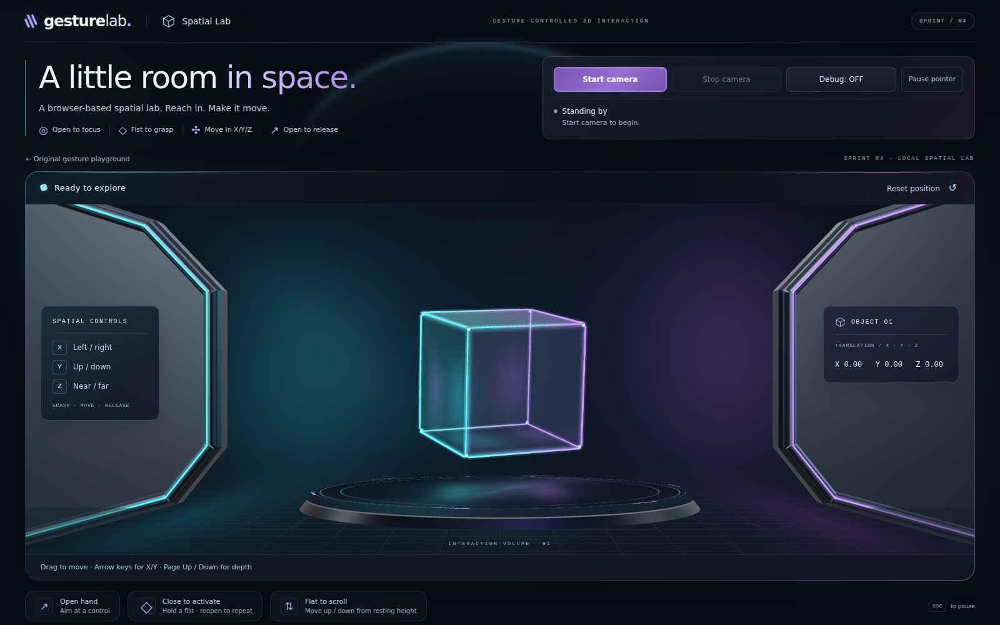

# Gesture Lab

**A browser-based experiment in controlling digital interfaces with hand gestures.** Aim, interact, scroll, and move a 3D object using a webcam—without a mouse or controller.



*Actual 1600 × 1000 browser capture of the Spatial Lab interface. No webcam feed or person appears in this cover image.*

## Explore the project

- **Spatial Lab (`/spatial-lab`)** · A cinematic WebGL room with an interactive glass cube. Focus on the cube with an upright open hand, close into a full fist to grasp it, move in X/Y/Z, and reopen to release. [Scene source](gesture-lab/src/components/SpatialLab.tsx).
- **Gesture playground (`/`)** · The original gesture-control experiments: focus and activate test buttons, scroll a page with a flat palm, and inspect recognition diagnostics. [Setup and control notes](gesture-lab/README.md).
- **[Showcase image and notes](showcase/README.md)** · The unaltered project screenshot, its provenance, and the demo limitation.

Both experiences are part of the same local application. The project is an **experimental prototype**, not a production-ready accessibility or hands-free input system.

## Run locally

Requirements: **Node.js 24+**, a webcam, a WebGL-capable modern browser, and reasonably even lighting.

```bash
git clone https://github.com/kobylikalex-cloud/visual_website.git
cd visual_website/gesture-lab
npm ci
npm run dev -- --host localhost --port 5173 --strictPort
```

Open **http://localhost:5173/spatial-lab** for the 3D experience, or **http://localhost:5173/** for the original gesture playground.

1. Grant camera permission and select **Start camera**.
2. Turn **Debug ON** before testing gestures (see the known issue below).
3. Use an upright open hand to focus, a complete fist to grasp or activate, and an open hand to release. In the playground, a flat palm moved above or below its neutral height scrolls the page.
4. Keep native mouse and keyboard input available as a fallback.

The preview, camera controls, and spatial scene all run in the browser. Hand recognition uses **MediaPipe Tasks Vision**; live webcam frames are processed locally rather than sent to a hosted inference API.

## Current limitations

> **Known demo issue — Debug OFF:** Gesture controls have been reported to become unresponsive when debugging is disabled. **Keep Debug ON** for live demonstrations until this is resolved. Debug mode also displays the local camera/landmark preview.

- Accuracy depends on lighting, camera angle, the user, and device performance. Automated tests do not establish reliability across real webcams.
- The 3D depth interaction uses a relative monocular estimate, not calibrated physical distance.
- This repository does **not** currently provide a public hosted demo. Run the project locally using the instructions above.

## Technology and checks

React · TypeScript · Vite · Three.js / WebGL · MediaPipe Tasks Vision · Web Workers

```bash
cd gesture-lab
npm test
npm run lint
npm run build
```

Development was assisted by OpenAI Codex. The application does **not** invoke an OpenAI model or API at runtime.
